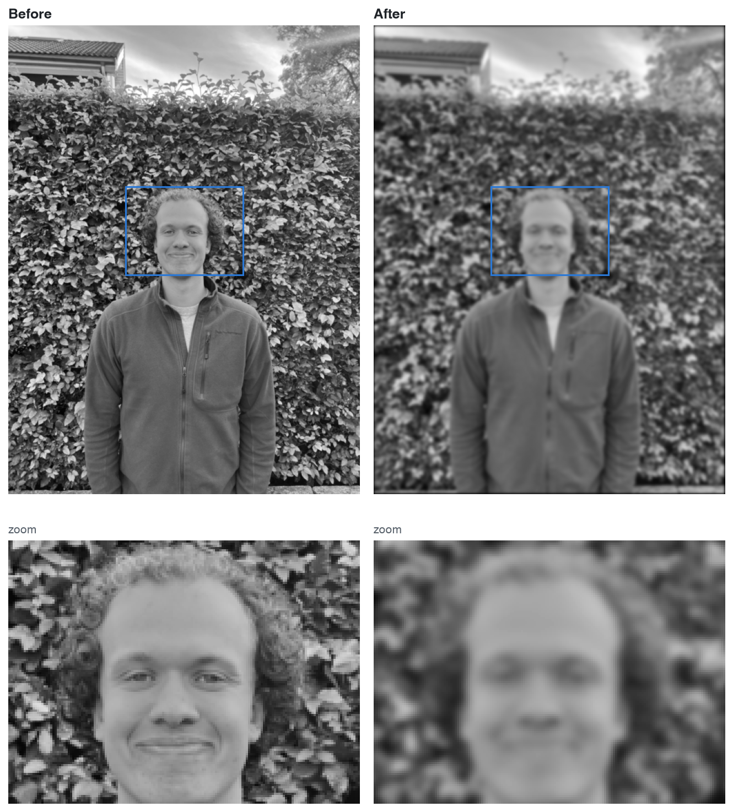
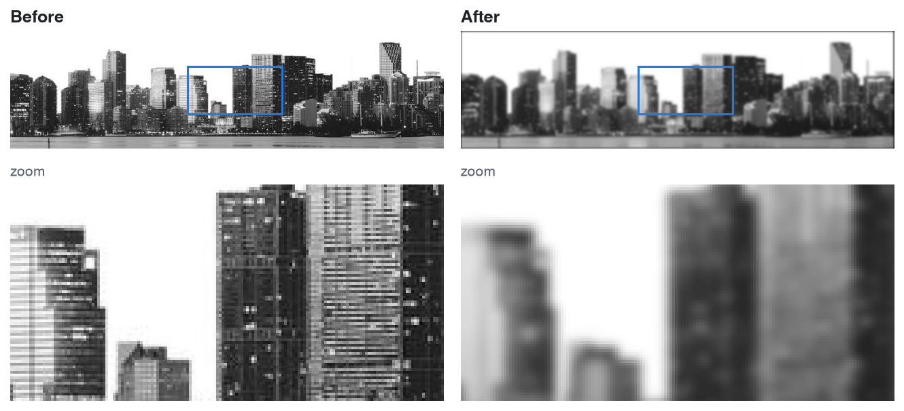
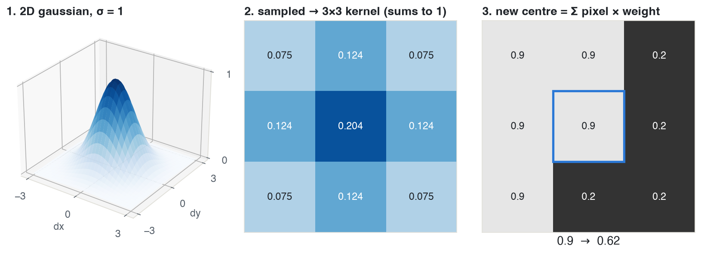
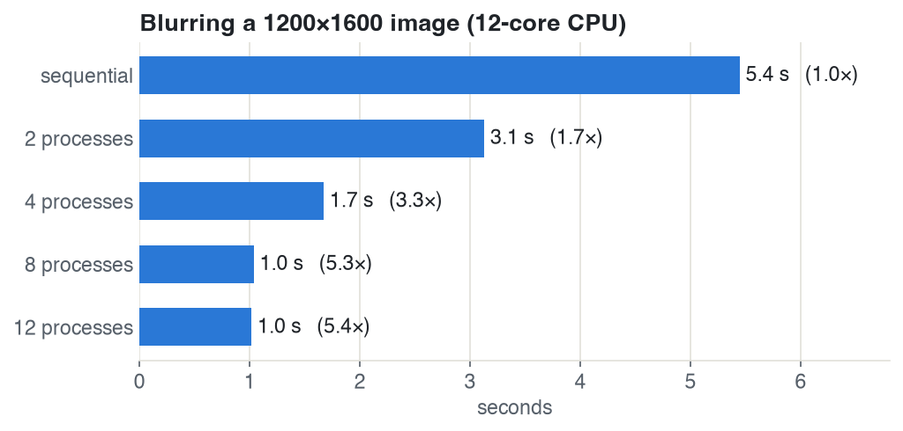

# Gaussian blur

A Gaussian blur written from scratch in Python. It uses a hand-built kernel and a per-pixel weighted sum, with no `scipy` or `cv2`. A second version runs it in parallel with `multiprocessing`.

## Before / after





<sub>3×3 kernel, σ = 2, applied 6 times so the effect is visible at this size.</sub>

## How it works



1. The kernel comes from a 2D Gaussian, so the centre pixel gets the most weight.
2. The Gaussian is sampled on a 3×3 grid and normalised so the weights sum to 1.
3. Each pixel is replaced by the weighted sum of its neighbourhood. Sharp edges get averaged out.

## Sequential vs parallel



The image is split into horizontal strips, and each strip is blurred in its own process (`Pool.map`). The speed-up levels off at about 5× around 8 processes. On the small city image, parallel is slower, because starting the processes takes longer than the blur.

## Structure

```
src/blur.py               kernel + blur
src/blur_concurrency.py   sequential vs parallel timing
src/gaussian.py           3D plot of the Gaussian
src/gol.py, graphics.py   Game of Life that reveals the blurred image (pygame)
scripts/make_figures.py   generates everything in docs/
```

## Run

```bash
pip install -r requirements.txt
# put imgs/city.jpg and imgs/me.png in place (imgs/ is gitignored)
python scripts/make_figures.py   # before/after, kernel and timing figures
```
